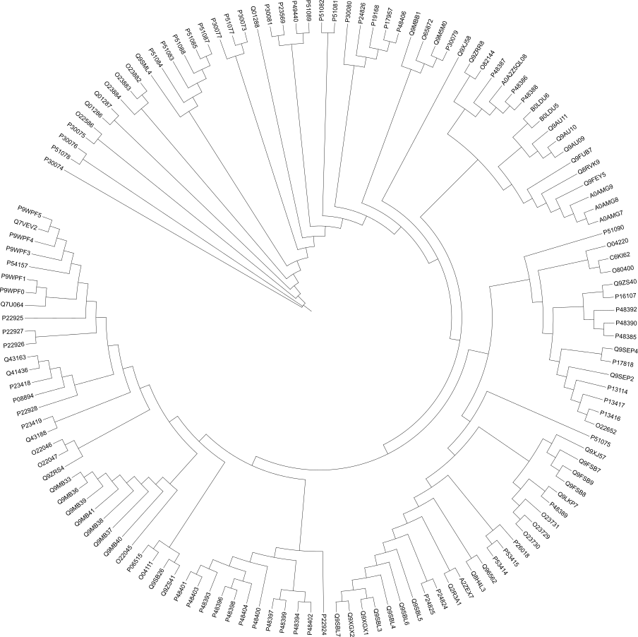
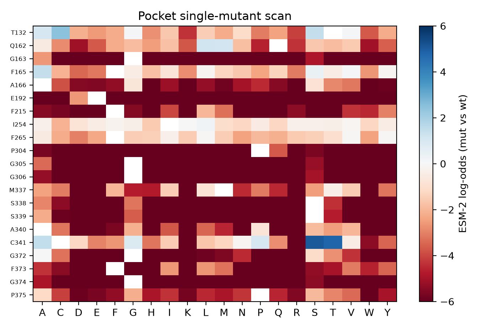
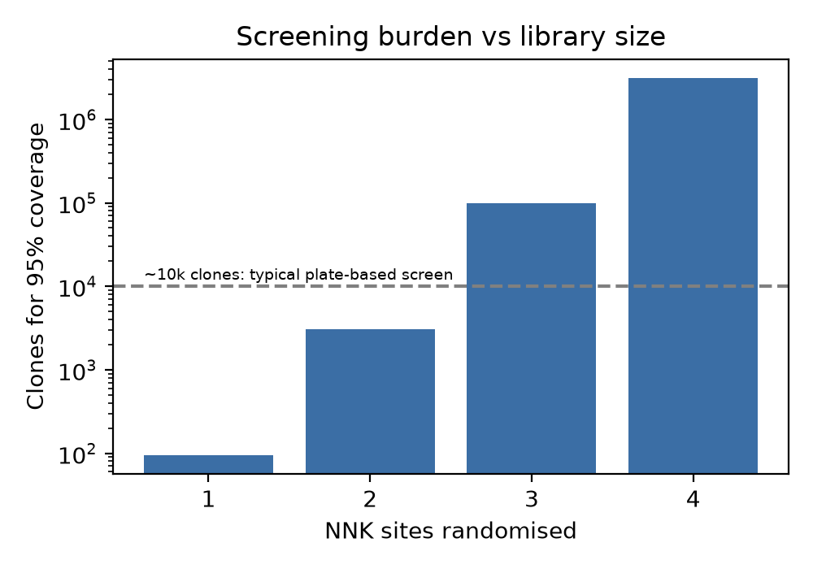
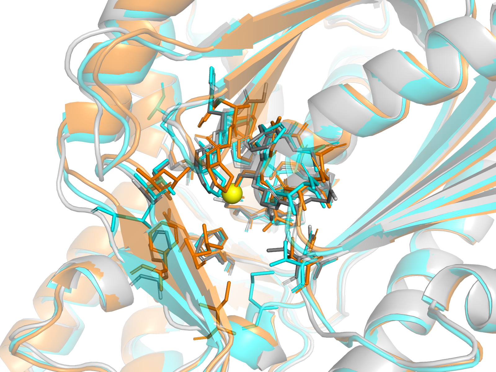

# Computational engineering of chalcone synthase (CHS) for naringenin production in *E. coli*

Mini end-to-end enzyme-engineering workflow on public data: candidate discovery, active-site profiling,
ML-guided mutation scoring and NNK library design.

> All results are **computational predictions**. No variant has been experimentally validated.

## Pipeline
| Step | Command | Output |
|---|---|---|
| 1. Fetch CHS family sequences (UniProt) | `python src/01_fetch_sequences.py` | `data/chs_all.fasta` |
| 2. Align (MAFFT), filter by catalytic triad | `mafft --auto data/chs_all.fasta > data/chs_aln.fasta` then `python src/02_filter_triad.py` | `data/chs_triad.fasta` |
| 3. Tree (IQ-TREE) | `iqtree -s data/chs_triad.fasta -m MFP -mset LG,WAG,JTT -mrate G,I+G -B 1000 -nt AUTO` | tree figure |
| 4. Pocket profiling of 1CGK | `python src/03_pocket.py` | `data/pocket.csv` |
| 5. ESM-2 mutation scan | `python src/04_esm_scan.py` | `data/esm_scores.csv` |
| 6. NNK library design | `python src/05_nnk.py` | size / coverage table |
| 7. Figures | `python src/06_plots.py` | `figures/` |
| 8. Structure prediction (manual) | ColabFold AlphaFold2 notebook, one run per candidate | `data/models/*_model.pdb` |
| 9. Model vs 1CGK comparison | `python src/07_compare_models.py <model.pdb> <name>` | `data/pocket_compare_*.csv` |
| 10. Overlay image | `pymol -cq src/08_overlay.pml` | `figures/pocket_overlay.png` |

The tree figure in `figures/chs_tree_circular.png` was rendered in iTOL from `data/chs_triad.fasta.treefile`.

## Results

### Sequence landscape

Maximum-likelihood tree of 140 triad-conserving CHS-family sequences (IQ-TREE, LG+G4, 1000 ultrafast bootstraps).
A small clade on very long branches is highly divergent from the rest and was excluded when choosing structure-prediction candidates.

### Pocket mutation scan

ESM-2 log-odds (mutant vs wild type) for every substitution at the 21 non-triad residues within 8 Å of Cys164 in 1CGK.
Most positions, especially the glycines (163, 305, 306, 372, 374), strongly resist change. Only a few positions tolerate or favour substitutions.

| Variant | ESM-2 score | Rationale |
|---|---|---|
| T132C | +2.45 | Highest-scoring change at a position ~6.5 Å from Cys164 |
| T132S | +1.42 | Conservative substitution, low risk |
| F165A | +1.45 | Phe165 is ~5 Å from Cys164; smaller side chain may widen the pocket |
| C341S | +5.04 | Strongest score, but ~7.6 Å out: a stability hypothesis, not a catalytic one |

Ser338 and Phe215 are the closest residues to Cys164 but score strongly negative, so they were not selected for randomisation.

### Library design

Randomising two NNK sites (Thr132 and Phe165) gives 1,024 codon combinations and needs about 3,070 clones for 95% coverage.
Three sites would need about 98,000, and four over 3 million. The proposed experiment is therefore a 2-site NNK library plus the four rational variants above.
The ~10k-clone line is an illustrative plate-screen capacity, not a fixed limit.

### Structural comparison of candidates

Two CHS candidates were chosen from different clades (rice CHS2, Q8H4L3; morning glory CHSB, P48398) and modelled with
ColabFold (AlphaFold2, single chain). Each model was superimposed on the alfalfa CHS2 crystal structure (1CGK).
Grey: 1CGK, cyan: rice, orange: Ipomoea, yellow sphere: catalytic Cys164.

| Model | Identity to 1CGK | CA RMSD (whole chain) | pLDDT (chain / pocket) | Pocket residues that differ |
|---|---|---|---|---|
| Q8H4L3 (rice) | 70% | 1.37 Å | 95.3 / 96.6 | S338A, C341T |
| P48398 (Ipomoea) | 65% | 3.38 Å | 94.4 / 96.2 | S338T, F165N, M337L, I254L |

Observations:
- The catalytic triad (Cys164, His303, Asn336) is conserved in both, and every pocket CA lies within 1.4 Å of its 1CGK counterpart.
- Most of the 24-residue pocket is identical across the three enzymes, which agrees with the conservation seen in the ESM scan.
- Rice carries Thr at the position that is Cys341 in alfalfa, matching the ESM preference for C341T (+4.8).
- Phe165, one of the two proposed NNK sites, is Asn in Ipomoea, so natural CHS enzymes do vary at this position.
- The larger whole-chain RMSD for Ipomoea (3.38 Å) despite an equally tight pocket suggests a displaced loop or domain, which was not investigated.

## Proposed validation
Variants would be cloned into the E. coli naringenin pathway strain and grown in 96-deep-well plates. Naringenin is
read out by HPLC or by a chalcone/flavanone absorbance or fluorescence screen (e.g. an in-cell biosensor), normalised
to OD600. Each plate carries wild-type, empty-vector and a catalytic-dead (Cys164Ala) control in at least 8 wells each;
a hit is a variant above wild-type mean + 3 SD in two independent rounds. Hits are re-streaked, sequenced, and
characterised for kcat/Km and expression (SDS-PAGE) to separate catalytic gains from higher expression.

## Data privacy
This project uses public data only (UniProt, PDB). If adapted to unpublished or proprietary sequences, they should
be processed locally rather than on public servers or hosted notebooks, and kept out of version control
(`data/private/` is git-ignored).

## Limitations
- ESM-2 scores (35M-parameter model) reflect evolutionary plausibility, not kcat, stability or expression. They are a prior for prioritising variants.
- The pocket is a distance cutoff (8 Å from the Cys164 sulfur) on one crystal structure, with no ligand bound.
- CHS functions as a homodimer. Candidates were modelled as single chains, so dimer-interface effects are not captured.
- Only two candidates were modelled, and the structures are predictions. High pLDDT supports the fold, not the fine geometry of side chains.
- Sequences come from reviewed UniProt entries, so the sampling is biased towards well-studied species.
- No docking, molecular dynamics, pathway modelling or wet-lab validation was done.

## Planned extensions
OpenMM MD of top variants, Boltz-2 co-folding with p-coumaroyl-CoA, COBRApy FBA, ProteinMPNN pocket redesign.
